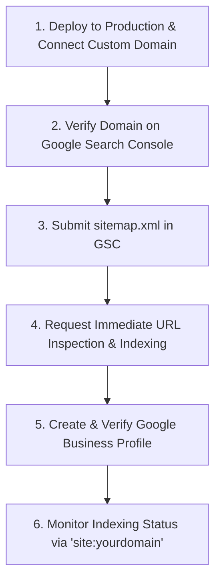

# Neotro Ltd — Production Deployment, SEO & Google Indexing Master Guide

| Field | Value |
| :--- | :--- |
| **Document Purpose** | Comprehensive deployment, SEO configuration, and search engine indexation runbook |
| **Project** | Neotro Ltd Corporate & Institutional Showcase Portal |
| **Workspace Root** | `c:\Development\Neotro Ltd` |
| **Application Directory** | `Neotro website/UI` |
| **Author / Lead** | Neotro Engineering Team |
| **Last Updated** | 2026-11-20 |
| **Status** | Active Operational Standard |

---

## 1. Executive Overview

Deploying a website makes the files accessible over the internet, but search engines (Google, Bing, Yahoo) will not automatically crawl, understand, or display it immediately in search results. To ensure **Neotro Ltd** ranks reliably, displays high-trust clickable rich snippets, and is easily discovered by decision-makers (schools, churches, construction firms, and enterprises), two complementary workflows must occur:

1. **On-Page & Technical SEO (Engineered directly in the codebase):** Metadata, XML sitemaps, crawl permissions (`robots.txt`), Schema.org JSON-LD structured data, dynamic title synchronization, and accessible heading structures.
2. **Off-Page & Search Console Integration (Executed by the operator post-deployment):** Custom domain DNS routing, Google Search Console ownership verification, instant indexing submission, Google Business Profile configuration, and inbound domain signals.

---

## 2. What Has Been Implemented in the Codebase

All required technical SEO infrastructure has been configured and validated in the production build:

### 2.1 Web Crawler Access Directives — `public/robots.txt`
* **File Location:** [`Neotro website/UI/public/robots.txt`](file:///c:/Development/Neotro%20Ltd/Neotro%20website/UI/public/robots.txt)
* **Status:** Created and active in build output (`dist/robots.txt`).
* **Directives:**
  ```txt
  User-agent: *
  Allow: /
  Disallow: /admin
  Disallow: /#admin

  Sitemap: https://neotro.ng/sitemap.xml
  ```
* **Purpose:** Instructs all search engine crawlers (Googlebot, Bingbot) that the showcase and public policy pages are open for crawling, while keeping the internal admin preview route private. It directly references the XML sitemap.

### 2.2 Search Engine Sitemap — `public/sitemap.xml`
* **File Location:** [`Neotro website/UI/public/sitemap.xml`](file:///c:/Development/Neotro%20Ltd/Neotro%20website/UI/public/sitemap.xml)
* **Status:** Created and active in build output (`dist/sitemap.xml`).
* **Content:**
  * Homepage (`/`): High priority (`1.0`), weekly crawl frequency.
  * Compliance Policy (`/data-protection-policy`): Priority (`0.8`), monthly crawl frequency.
* **Purpose:** Provides Googlebot with an explicit, authoritative index of all canonical URLs on the domain without waiting for algorithmic page discovery.

### 2.3 HTML Head & Primary Metadata — `index.html`
* **File Location:** [`Neotro website/UI/index.html`](file:///c:/Development/Neotro%20Ltd/Neotro%20website/UI/index.html)
* **Title Tag:** 
  `Neotro Ltd — Intelligent Software Systems & Digital Portals for Nigerian Institutions`
* **Meta Description:**
  `Neotro Ltd engineers purpose-built software platforms, school portals, construction takeoff tools, and custom business workflows across Africa. NDPA 2023 aligned.` (~165 characters, optimized for mobile and desktop SERP truncation limits).
* **Keywords Tag:** 
  `Neotro Ltd, school portal Nigeria, school management system Lagos, construction takeoff software, quantity surveying software Nigeria, AI assessment engine, biometric attendance Nigeria, NDPA compliant software, educational ERP Africa`
* **Robots Policy:**
  `<meta name="robots" content="index, follow, max-image-preview:large, max-snippet:-1, max-video-preview:-1" />` (ensures Google indexes pages and displays high-resolution preview images).
* **Canonical URL:**
  `<link rel="canonical" href="https://neotro.ng/" />` (eliminates duplicate content penalties).
* **Brand Assets:**
  Favicon `<link rel="icon" type="image/svg+xml" href="/favicon.svg" />` and theme color `<meta name="theme-color" content="#093824" />`.

### 2.4 Social Open Graph & Twitter Cards — `index.html`
* **Open Graph Tags:** `og:type="website"`, `og:site_name="Neotro Ltd"`, `og:title`, `og:description`, `og:url`, `og:locale="en_NG"`, and `og:image="https://neotro.ng/logos/neotro-africa-full-green.jpg"`.
* **Twitter Card Tags:** `twitter:card="summary_large_image"`, `twitter:title`, `twitter:description`, and `twitter:image`.
* **Purpose:** Generates high-contrast, professional link preview cards when the site URL is shared on LinkedIn, WhatsApp, X (Twitter), Slack, or Telegram.

### 2.5 Schema.org JSON-LD Structured Data — `index.html`
* **Entities Declared:** `Organization` + `WebSite`
* **Legal Name:** Neotro Limited
* **HQ Location:** Lagos, Nigeria (`NG`)
* **Contact Channel:** `contact@neotro.com`
* **Social Profiles:** `https://linkedin.com/company/neotro-ltd`
* **Purpose:** Enables Google's Knowledge Graph to recognize Neotro Ltd as an established corporate entity and unlocks eligibility for Google Rich Snippets and Knowledge Panels.

### 2.6 Dynamic Route Title Synchronization — `src/App.tsx`
* **File Location:** [`Neotro website/UI/src/App.tsx`](file:///c:/Development/Neotro%20Ltd/Neotro%20website/UI/src/App.tsx)
* **Mechanism:** React `useEffect` dynamically alters `document.title` on client-side route changes:
  * Default Showcase: `Neotro Ltd — Intelligent Software Systems & Digital Portals for Nigerian Institutions`
  * Policy Page: `Data Protection & Privacy Policy — Neotro Ltd`

### 2.7 Heading Hierarchy & Image Alt Text Audit
* **Single H1 Rule:** Main showcase contains exactly one `<h1>` (`BUILDING INTELLIGENT SYSTEMS THAT MAKE WORK EFFORTLESS.`). The Data Protection Policy page contains its own solitary `<h1>` (`Data Protection & Privacy Policy`).
* **Semantic Sub-levels:** Sections use `<h2>` (About, Solutions, Why Us, Partners, Contact) and subsections use `<h3>`/`<h4>`.
* **Image Accessibility:** Platform previews (`Neotro Academy`, `Lecturra AI`) and brand graphics all contain descriptive, informative `alt` text.

---

## 3. Post-Deployment Operator Runbook

Follow these sequential steps once the code is pushed to your production hosting environment (Vercel, Netlify, or custom web server).



---

### Step 1: Connect a Custom Domain

Using a generic hosting subdomain (such as `neotro.vercel.app` or `neotro.netlify.app`) harms conversion rates and search rankings. A dedicated custom domain (`neotro.ng` or `neotroltd.com`) establishes enterprise legitimacy and indexation authority.

#### Configuration Instructions (Vercel / Netlify):
1. Log in to your hosting provider dashboard (e.g., [vercel.com](https://vercel.com)).
2. Navigate to your project → **Settings** → **Domains**.
3. Add your custom domain (e.g., `neotro.ng` and `www.neotro.ng`).
4. Log in to your domain registrar (such as Whogohost, Namecheap, GoDaddy, QServers).
5. In your DNS Zone Editor, create the following records:
   * **Apex Domain (`neotro.ng`):**
     * **Type:** `A`
     * **Name:** `@` (or leave blank depending on registrar)
     * **Value:** `76.76.21.21` (Vercel default)
     * **TTL:** `3600` (or Automatic)
   * **Subdomain (`www.neotro.ng`):**
     * **Type:** `CNAME`
     * **Name:** `www`
     * **Value:** `cname.vercel-dns.com`
     * **TTL:** `3600`
6. Wait 5–30 minutes for DNS propagation. Your host will automatically issue a free Let's Encrypt SSL/TLS certificate.
7. If your live domain differs from `neotro.ng`, update the domain references in [robots.txt](file:///c:/Development/Neotro%20Ltd/Neotro%20website/UI/public/robots.txt), [sitemap.xml](file:///c:/Development/Neotro%20Ltd/Neotro%20website/UI/public/sitemap.xml), and [index.html](file:///c:/Development/Neotro%20Ltd/Neotro%20website/UI/index.html).

---

### Step 2: Set Up Google Search Console (GSC)

Google Search Console is Google's official, free tool to manage your search presence, monitor indexing health, submit sitemaps, and diagnose crawl errors.

#### Verification Instructions:
1. Open [Google Search Console](https://search.google.com/search-console/) and sign in with your corporate Google/Gmail account.
2. Click **Add Property** in the top-left dropdown.
3. Select between two property types:
   * **Option A: Domain Property (Recommended):**
     * Enter your naked domain: `neotro.ng`.
     * Copy the provided `TXT` record token (e.g., `google-site-verification=abc123xyz...`).
     * In your domain DNS manager, add a new `TXT` record with host `@` and value as the token.
     * Click **Verify** in Search Console.
   * **Option B: URL Prefix Property (Instant HTML Tag):**
     * Enter `https://neotro.ng`.
     * Choose the **HTML Tag** verification method.
     * Copy the verification token from the code snippet.
     * In [index.html](file:///c:/Development/Neotro%20Ltd/Neotro%20website/UI/index.html), uncomment and paste the token on line 39:
       ```html
       <meta name="google-site-verification" content="PASTE_YOUR_TOKEN_HERE" />
       ```
     * Commit, deploy, and click **Verify**.

---

### Step 3: Submit Your XML Sitemap

1. In the left sidebar of Google Search Console, click **Sitemaps** (under the "Indexing" section).
2. Under **Add a new sitemap**, type:
   ```text
   sitemap.xml
   ```
3. Click **Submit**.
4. GSC will fetch `https://neotro.ng/sitemap.xml` and report:
   * **Status:** `Success`
   * **Discovered Pages:** `2` (Homepage and Data Protection Policy).

---

### Step 4: Request Immediate Indexing via URL Inspection

Instead of waiting for Googlebot's periodic web crawl, submit an explicit on-demand crawl request:

1. At the top of Google Search Console, find the **"Inspect any URL in..."** search bar.
2. Enter your live homepage URL:
   ```text
   https://neotro.ng/
   ```
3. Press **Enter**. Google will check its index. (For a new site, it will display *"URL is not on Google"*).
4. Click **Test Live URL** (located at the top right) to verify that Googlebot can load the page without errors or blocking scripts.
5. Once the live test passes, click **Request Indexing**.
6. Repeat this process for:
   ```text
   https://neotro.ng/data-protection-policy
   ```
7. Your URLs will be prioritized in the immediate crawling queue.

---

### Step 5: Create a Google Business Profile

For B2B software and digital service providers in Nigeria, having a verified Google Business Profile links your physical presence, official website, phone contacts, client reviews, and direct Google Maps pins directly into local Search results.

#### Setup Checklist:
1. Visit [Google Business Profile Manager](https://www.google.com/business/) and click **Sign In**.
2. **Business Name:** `Neotro Limited` or `Neotro Ltd`.
3. **Primary Category:** `Software Company` or `Information Technology Services`.
4. **Secondary Categories:** `Computer Consultant`, `Educational Consultant`, `Data Processing Service`.
5. **Location & Service Area:**
   * Address: Your registered office in Lagos, Nigeria.
   * Service Area: Select **Nigeria**, **Lagos State**, and any regional territories served.
6. **Contact Information:**
   * Phone Number: Official corporate line / WhatsApp business contact.
   * Website: `https://neotro.ng`
   * Email: `contact@neotro.com`
7. **Business Hours:** Specify your working days and client support hours (e.g., Monday–Friday, 8:00 AM – 5:00 PM WAT).
8. **Products & Services Catalog:** Add individual products matching the website solutions:
   * *Neotro School Management Portal*
   * *Neoppe QS Digital Estimating & BOQ Takeoff Suite*
   * *Lecturra AI Academic Assessment Engine*
   * *SmartCheck Verifiable Biometric & RFID Attendance*
9. **Verification:** Complete Google's verification method (SMS, phone call, business video, or postcard).

---

### Step 6: Verify Live Indexing on Google Search

Search engines usually require **48 hours to 2 weeks** to index and rank a new domain. To monitor whether your site has entered Google's active index:

1. Open [Google Search](https://www.google.com).
2. In the search box, execute the exact query:
   ```text
   site:neotro.ng
   ```
   *(Substitute your actual domain if different).*
3. **What You Will See:**
   * **If indexed:** Google will list all indexed pages with the titles, descriptions, and URLs matching your metadata.
   * **If not yet indexed:** Google will display *"Your search - site:neotro.ng - did not match any documents."* This indicates Googlebot is still processing the crawl queue.

---

## 4. Off-Page Signals to Accelerate Discovery

Google indexes sites faster when external trustworthy websites link to them. Boost discovery speed with these initial steps:

1. **LinkedIn Company Page:** Create or update the official **Neotro Ltd** LinkedIn page, linking directly to `https://neotro.ng` in the website field.
2. **Founder & Staff Profiles:** Update work experience links on leadership and developer LinkedIn profiles.
3. **Online Tech & Business Directories:**
   * Register on Nigerian business registries (VConnect, BusinessList.ng, Finelib).
   * Register on global software directories (Crunchbase, ProductHunt, GitHub Organization profile).
4. **Partner & Client Cross-links:** Coordinate with partner institutions (e.g., Attwool Schools, Tosphy Geo-Spatial) to mention software infrastructure provided by Neotro Ltd with a link back to your portal.

---

## 5. Ongoing SEO Maintenance Checklist

| Cadence | Action Item | Verification Method |
| :--- | :--- | :--- |
| **Weekly (Post-Launch)** | Review Google Search Console **Coverage** and **Performance** reports. | Verify there are zero `404 Not Found` or `Server error (5xx)` crawl errors. |
| **Monthly** | Inspect top search queries, clicks, and impressions in GSC. | Identify keywords institutional clients use to find your portals. |
| **Upon New Page / Feature** | Add new routes to `sitemap.xml` with updated `<lastmod>` timestamps. | Re-submit sitemap in GSC. |
| **Quarterly** | Test website loading speed via Google PageSpeed Insights. | Maintain scores above 90+ on mobile and desktop performance. |
| **Continuous** | Keep client reviews active on your Google Business Profile. | Encourage partner schools and firms to leave 5-star institutional ratings. |

---

*This guide is saved in the workspace root at `c:\Development\Neotro Ltd\SEO_AND_INDEXING_GUIDE.md` for permanent engineering and operations reference.*
